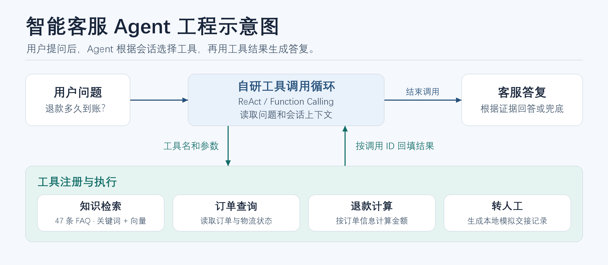

# 电商售后智能客服 Agent

Python 单机演示项目。用混合检索回答售后 FAQ，用工具查询模拟订单、计算退款金额，并将转人工交接记录写入本地文件。CLI 和 Web 共用同一个工具调用循环。

## 离线演示

在仓库根目录用 Python 3.12 启动。首次运行会直接使用配置模板和默认的 `hash` 检索后端，无需安装依赖、配置 API Key 或下载模型。

```bash
python webapp/server.py
```

打开 [127.0.0.1:8765](http://127.0.0.1:8765)，保留默认选中的 **离线演示**。工作台提供售后问答、订单查询、退款试算和转人工交接四个入口。查单和试算表单可直接填入示例订单，会话面板会显示本轮调用的工具及耗时。

| 输入 | 演示结果 |
| --- | --- |
| `退款多久能到账？` | 检索 FAQ，返回退款时效 |
| `订单 JD20260815001 到哪了？` | 查询模拟订单，显示发货和物流状态 |
| `订单 JD20260815001 可以退多少钱？` | 按普通退款规则试算 ¥179 |
| `转人工客服` | 生成本地交接文件，保存在 `data/handoffs/` |

终端演示可运行 `python main.py --mock --verbose`。Mock 使用规则选择工具。

## 监控演示

1. 在工作台用示例订单跑一次退款试算，给这条回复点「有帮助」。
2. 点回复下方的「查看本轮记录」，核对请求编号、运行模式、耗时、工具顺序和反馈。
3. 关闭详情，在[运行监控](http://127.0.0.1:8765/monitor)切换「离线演示」和「退款试算」筛选，查看回复返回率、P95 和有帮助率。

看板汇总实际跑过的本机请求。新启动后先完成一轮会话即可看到记录。测试评价属于演示样本，反馈指标同时显示分母。

## 实现

真实模式用 Function Calling 选择工具，按 `tool_call_id` 回填结果。FAQ 召回融合向量与关键词得分，再用规则重排。Web 提供 SSE、会话落盘和本地日志。



| 路径 | 内容 |
| --- | --- |
| [`main.py`](main.py)、[`webapp/`](webapp/) | CLI、HTTP 服务及聊天页面 |
| [`core/`](core/)、[`tools/`](tools/)、[`rag/`](rag/) | 工具调用循环、业务工具、检索和索引构建 |
| [`data/`](data/) | 从 JDDC 对话候选整理的 47 条 FAQ、模拟订单和回归数据 |
| [`eval/`](eval/)、[`tests/`](tests/)、[`scripts/`](scripts/) | 离线回归、单测、数据准备和真实模型冒烟 |

## 接入真实模型

安装 `python -m pip install -r requirements.txt`。把 [配置模板](config.example.json)复制为 `config.json`，填入 `api_key` 并确认 `base_url` 和 `model`。若已有 `config.json`，直接修改本地文件。重新启动 Web，在会话面板选择「真实模型」，或在 CLI 运行 `python main.py`。

## 本地验证

```bash
python -m pip install -r requirements-dev.txt
python -m pytest tests/ -q
python -m eval.eval_script
```

本地验证包含 24 项测试和 58 条 mock 回归。回归检查工具和回答关键词。真实模式目前有历史小样本冒烟记录，多轮指代和回答正确性仍需要专门评测。

依赖、配置和数据维护见 [项目说明](docs/项目说明.md#开发与维护)。检索实验见 [Embedding 选型报告](docs/embedding选型报告.md)，项目讲解见 [面试项目介绍](docs/面试项目介绍.md)。早期设计和调试记录保存在 [docs/archive](docs/archive/)。
